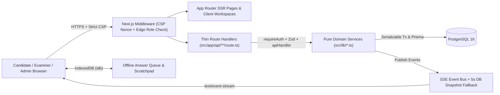

# AegisExam — Secure Examination Management System

AegisExam is an enterprise-grade, full-stack online examination management platform built for the **Technoverse 5.0 Web-e-Thon** using a **Spec-Driven Software Development** methodology. It unifies role-isolated workflows for **Administrators**, **Examiners**, and **Candidates** with strict server-side security invariants, offline-resilient exam delivery, stratified paper fairness, live SSE monitoring, QR-verified PDF scorecards, and audited dispute resolution.

> **Competition Compliance:** Zero paid APIs, external billing services, or proprietary datasets are used. All dependencies are open-source and self-contained (including offline-safe CSS typography and bundled PDFKit AFM font assets in Docker).

---

## Table of Contents

1. [Judge & Evaluation Walkthrough (15-Minute Demo)](#judge--evaluation-walkthrough-15-minute-demo)
2. [Seeded Evaluation Accounts & Fixtures](#seeded-evaluation-accounts--fixtures)
3. [System Architecture & Tech Stack](#system-architecture--tech-stack)
4. [Security & Integrity Invariants](#security--integrity-invariants)
5. [Core & Secondary Features (Sections 03 & 04)](#core--secondary-features-sections-03--04)
6. [Open Innovation Challenges (Section 05)](#open-innovation-challenges-section-05)
7. [API Reference](#api-reference)
8. [UI Routes & Role Workspaces](#ui-routes--role-workspaces)
9. [Database Schema (Prisma / PostgreSQL)](#database-schema-prisma--postgresql)
10. [Local Setup, Docker & Cloud Deployment](#local-setup-docker--cloud-deployment)
11. [Verification & Test Suite](#verification--test-suite)

---

## Judge & Evaluation Walkthrough (15-Minute Demo)

1. **Administrator RBAC & Platform Operations (`admin@aegisexam.local`)**
   - Inspect `/admin`, `/admin/users` (paginated user/role directory, confirmation-guarded deactivation/role changes, password resets), `/admin/audit` (filtered immutable `AuditLog`), and `/admin/health` (live PostgreSQL latency check).
2. **Examiner Authoring, Stratified Fairness & Sandbox (`examiner1@aegisexam.local`)**
   - Browse `/examiner/questions` (paginated Question Bank + CSV/JSON dry-run bulk import modal).
   - Open `/examiner/exams/seed-exam-ongoing` → **3. Fairness Inspector** → **Run 20-paper simulation** to verify deterministic difficulty balance (`σ = 0` across stratified `Topic × Difficulty` rules) and `100%` topic coverage.
   - Open **Preview in sandbox** (`/examiner/exams/seed-exam-ongoing/sandbox`) to experience the workspace without affecting live monitoring, submissions, or analytics (`isSandbox: true`).
3. **Resilient Live Candidate Delivery (`candidate1@aegisexam.local`)**
   - Enter `CS-301 Live Stratified Assessment` from `/candidate/dashboard` after confirming pre-exam readiness.
   - Toggle Dark / High-Contrast themes, open the **Digital Scratchpad** (canvas + quick notes persisted in IndexedDB), toggle **Offline** mode in DevTools while answering, observe `Offline — answers safely queued locally`, then reconnect to watch monotonic `clientSeq` sync complete cleanly.
4. **Live SSE Monitoring & Audited Accommodations (`/examiner/exams/seed-exam-ongoing/monitor`)**
   - Broadcast a live announcement to active candidates via SSE, inspect candidate connectivity (`ONLINE` / `GAP`) and neutral review signals, and grant an audited outage extension (`+minutes` with mandatory justification) without altering `hardDeadlineAt`.
5. **Grading, Analytics, QR-Verified PDF & Dispute Supersession**
   - Review `/examiner/exams/seed-exam-results/analytics` (cohort mean/median/range/pass rate, histogram, question difficulty `p`, skip & distractor stats, cohort PDF export).
   - As `candidate1@aegisexam.local`, open the published result on `/candidate/results/seed-result-attempt-1`, download the **QR-verified PDF**, verify it publicly on `/verify/AEG-XXXX-XXXX` (masked privacy-safe fields only), and file a dispute (`DisputePanel`).
   - As `examiner1@aegisexam.local`, resolve the dispute on `/examiner/disputes` with a score adjustment — automatically recomputing totals and superseding v1 verification (`REVOKED SUPERSEDED`) while issuing a fresh v2 verification code.

---

## Seeded Evaluation Accounts & Fixtures

All accounts below are idempotently seeded by `prisma/seed.ts`. Self-service password rotation is available to every logged-in user via **Change password** in the sidebar.

| Role | Email | Password | Pre-Seeded Scope |
|---|---|---|---|
| **Administrator** | `admin@aegisexam.local` | `Admin@123!` | Platform overview, user/role management, audit log, system health |
| **Examiner 1** | `examiner1@aegisexam.local` | `Examiner@123!` | 24 reusable questions (`Algorithms`, `Databases`, `Networks`), 4 exams (`ongoing`, `upcoming`, `draft`, `results`), 3 graded results |
| **Examiner 2** | `examiner2@aegisexam.local` | `Examiner@123!` | Secondary examiner isolated from Examiner 1's private bank & exams |
| **Candidates 1–5** | `candidate1@aegisexam.local` … `candidate5@aegisexam.local` | `Candidate@123!` | Enrolled in `seed-exam-ongoing`; Candidates 1–3 enrolled in `upcoming` & `results` |

### Seeded Examination Fixtures
- **`seed-exam-ongoing` (`CS-301 Live Stratified Assessment`)**: `ONGOING`, Stratified Fairness Blueprint (`6` rules, `18` marks), shuffled questions & choices.
- **`seed-exam-upcoming` (`SE-402 Scheduled Final Examination`)**: `PUBLISHED`, scheduled `+48h` to `+52h`, backend entry-locked until window opens.
- **`seed-exam-results` (`CS-210 Published Midterm Results`)**: `COMPLETED` & published with 3 graded attempts (`9/10`, `4.5/10`, `7/10`) for analytics, scorecard PDFs, and disputes.

---

## System Architecture & Tech Stack

### Technology Stack
- **Frontend & SSR:** Next.js `15.5.29` (App Router, `output: "standalone"`), React `19`, TypeScript (`"strict": true`), Tailwind CSS `4`, `lucide-react`
- **Backend & ORM:** Next.js Route Handlers (`src/app/api/**`), Prisma ORM `6.12.0`, PostgreSQL `16`, Zod `4` validation
- **Security:** `jose` HMAC-JWT cookies, `bcryptjs` password hashing (`cost 12` for new/rotated passwords), CSP nonces & security headers (`src/middleware.ts`, `next.config.ts`)
- **Offline & Real-Time:** `idb` (IndexedDB answer mutation queue & scratchpad), Node `EventEmitter` SSE stream (`src/lib/event-bus.ts`, `src/app/api/exams/[id]/stream/route.ts`)
- **Imports & Reports:** `papaparse` (CSV/JSON dry-run + commit imports), `pdfkit` + `qrcode` (QR-verifiable scorecards & cohort reports)
- **Verification:** Vitest (unit/integration) + Playwright (full multi-role E2E & UI accessibility tests)

### Architectural Flow



### Repository Structure
- `src/app/` — App Router pages (`20` page routes across role portals, exam workspace, and public verification) and `43` API route files (`src/app/api/**/route.ts`)
- `src/components/ui/` — Shared accessible design-system primitives (`Modal`, `Drawer`, `ConfirmDialog`, `AlertBanner`, `StatusBadge`, `Tabs`, `Breadcrumb`, `DataTableControls`, `FormField`, `EmptyState`)
- `src/components/` — Role shells, `ChangePasswordModal`, `AdminUserManager`, `AuditTrailViewer`, `examiner/**`, `candidate/**`, `exam/**`, `results/**`
- `src/lib/` — Pure domain services (`fairness.ts`, `attempts.ts`, `grading.ts`, `analytics.ts`, `verification.ts`, `pdf-reports.ts`, `bulk-import.ts`, `disputes.ts`, `monitoring.ts`, `exam-lifecycle.ts`, `password-change.ts`, `offline-queue.ts`, `pagination.ts`, `rate-limit.ts`, `auth.ts`, `rbac.ts`, `api-handler.ts`)
- `docs/` — Master specification, phased plans (`01`–`06`), architecture decisions (`DECISIONS.md`), work log (`WORK_DONE.md`), and handoffs (`docs/handoffs/`)

---

## Security & Integrity Invariants

1. **Strict Backend RBAC & Active Account Checks**: Every protected `/api/*` endpoint invokes `requireAuth(allowedRoles)` and validates `user.isActive` plus resource ownership (`exam.createdById === session.userId` or `attempt.userId === session.userId`).
2. **Hardened Session & Password Controls**:
   - Cookies use `httpOnly: true`, `sameSite: "strict"`, and `secure: true` in production (`src/lib/auth.ts`).
   - `User.tokenVersion` immediately revokes prior JWT sessions on logout, admin password reset, role change, account deactivation, and self-service password rotation.
   - Passwords enforce 12+ chars (upper/lower/digit/symbol) via `PasswordSchema` with constant-time dummy hash verification (`DUMMY_BCRYPT_HASH`) and sliding-window per-email / per-IP / per-user rate limiting (`src/lib/rate-limit.ts`, `TRUST_PROXY`-aware).
3. **Zero Answer-Key Leakage**: `Question.correctIdsJson`, `AttemptQuestionSnapshot.correctIdsSnap`, and `explanation` are stripped from candidate start/sync/result DTOs unless `exam.resultsPublishedAt !== null && exam.revealAnswersAfterPublish === true`.
4. **CSP & Request Guards**: `src/middleware.ts` generates per-request cryptographic script nonces and `frame-ancestors 'none'`; `next.config.ts` sets `X-Content-Type-Options: nosniff`, `X-Frame-Options: DENY`, `Permissions-Policy`, and `Strict-Transport-Security`; `apiHandler()` validates `Sec-Fetch-Site`, `Origin` vs `NEXT_PUBLIC_APP_ORIGIN`, and `Content-Type: application/json` on mutations.
5. **Server-Authoritative Timing & Atomic Finalization**:
   - `hardDeadlineAt = min(startedAt + durationMinutes, scheduledEnd)` is computed on the server and never overwritten.
   - `effectiveDeadlineAt = hardDeadlineAt + timeExtensionMinutes` governs answer acceptance through `effectiveDeadlineAt + 5000ms` (5s in-flight grace buffer).
   - Final submission (`POST /api/attempts/[id]/submit`) applies any queued monotonic answers and performs a conditional `IN_PROGRESS` → `SUBMITTED` update in a `Serializable` transaction with retry handling against write-conflict races.
6. **Sandbox Isolation (`isSandbox: false`)**: Every monitoring, grading, publication, analytics, leaderboard/report, and dispute query strictly filters out `isSandbox: true` attempts.
7. **Non-Conclusive Monitoring Policy**: `TAB_BLUR`, `FULLSCREEN_EXIT`, `PASTE_ATTEMPT`, and `HEARTBEAT_LOST` are recorded solely as neutral review signals and never auto-fail or lock out candidates.
8. **Privacy-Safe Public Verification**: `/verify/[code]` exposes only masked candidate identifier, candidate name, exam title, score, issue timestamp, version, and status (`VALID` / `REVOKED_SUPERSEDED` / `NOT_FOUND`) — never email addresses, questions, responses, or monitoring timelines.

---

## Core & Secondary Features (Sections 03 & 04)

| Requirement | Implementation Highlights |
|---|---|
| **3.1 Auth & RBAC** | Fixed `ADMIN` / `EXAMINER` / `CANDIDATE` roles, admin user provisioning/role/status console, audit log viewer, and self-service password change modal across all portals |
| **3.2 Exam Management** | Auto-reconciled lifecycle (`DRAFT` → `PUBLISHED` → `ONGOING` → `COMPLETED`), modular 5-tab Exam Builder with unsaved-edit confirmation and transition confirmation dialogs |
| **3.3 Question Management** | Paginated reusable Question Bank supporting `SINGLE_MCQ`, `MULTI_SELECT`, and `WRITTEN` items, per-attempt option/question randomization, immutable `AttemptQuestionSnapshot` freeze |
| **3.4 Candidate Enrollment** | Selective candidate picker + bulk CSV/JSON enrollment, server window enforcement (`Available Now` / `Upcoming` / `Completed`), pre-exam readiness confirmation |
| **3.5 Exam Delivery UI** | Single-question focus canvas, icon+color+label `QuestionPalette`, keyboard shortcuts (`N`/`P`/`M` safely guarded when overlays open), Light/Dark/High-Contrast themes, debounced written sync + IndexedDB queue, rich receipt card |
| **3.6 Live Monitoring** | Live SSE + 5s DB snapshot fallback (`/examiner/exams/[id]/monitor`), filters (`Online` / `Gap` / `Has Signals` / `Submitted`), broadcast announcements, neutral incident drawer |
| **3.7 Evaluation & Grading** | Automatic scoring for single-choice and all 3 `MultiSelectScoring` rules (`ALL_OR_NOTHING`, `PARTIAL_NO_NEGATIVE`, `PARTIAL_WITH_NEGATIVE` with negative ratio), validated written grading workbench |
| **3.8 Results & Analytics** | Explicit examiner publication gating, candidate result portal (`/candidate/results/[attemptId]`), cohort histogram & statistics |
| **4.1 Network-Aware Interface** | Distinct `Synced`, `Saving…`, `Offline — X answers queued locally`, `Offline — reconnection pending`, and `Sync error (Retry)` indicator; 10s heartbeat decoupled from typing |
| **4.2 PDF Reports** | Individual QR-verified candidate scorecards (`/api/reports/attempt/[attemptId]/pdf`) and cohort summary PDFs (`/api/reports/exam/[examId]/pdf`) generated via `pdfkit` |
| **4.3 Examination Sandbox** | Shared Candidate Workspace in examiner preview mode (`/examiner/exams/[id]/sandbox`) with banner, reset control, and `isSandbox: true` isolation |
| **4.4 Bulk Data Import** | Two-step dry-run validator & transactional importer (`papaparse`) for questions CSV/JSON and candidates CSV/JSON with optional exam auto-enrollment |
| **4.5 Question Analytics** | Observed difficulty index `p`, full-correctness %, skip rate %, distractor selection frequencies, and automated quality review flags |
| **4.6 Verifiable Reports** | HMAC-SHA256 signed `ReportVerification` records with unique `AEG-XXXX-XXXX` codes, embedded QR codes, and direct lookup at `/verify/[code]` |
| **4.7 Custom Workspace** | Server + `localStorage` persisted preferences: font size (`sm`/`md`/`lg`), theme (`light`/`dark`/`high-contrast`), palette side (`left`/`right`), compact mode, hide-timer (with accessible 5m/1m cues) |
| **4.8 Digital Scratchpad** | Per-attempt IndexedDB freehand drawing canvas (pen, eraser, undo stack, clear) and debounced rough math/text notes |

---

## Open Innovation Challenges (Section 05)

### 1. Fairness of Randomized Examinations (5.2)
- **Mechanism (`src/lib/fairness.ts`)**: Examiners define **Stratified Blueprint Rules** (`Topic × Difficulty` quotas and marks) or fixed questions. When an attempt begins, a deterministic `HMAC-SHA256` seed generates a unique permutation per candidate inside each stratum.
- **Validation Tool**: The **20-Paper Fairness Variance Inspector** simulates 20 candidate papers prior to publishing, displaying mean difficulty, difficulty standard deviation (`σ`), spread, and topic coverage (`100%`).
- **Trade-off**: Eliminates luck-based difficulty disparity across randomized forms (`σ = 0` for stratified rules) in exchange for requiring sufficient question-bank depth per `(topic, difficulty)` cell before publication.

### 2. Failure-Resilient Examinations (5.3)
- **Mechanism (`src/lib/offline-queue.ts`, `src/lib/attempts.ts`)**: Answers persist immediately in browser IndexedDB with monotonic `clientSeq` numbers (`shouldApplyMutation` ignores stale out-of-order replays). Disconnections queue writes locally and flush automatically via `online` listeners + 5s probes + exponential backoff, or atomically with `POST /api/attempts/[id]/submit`.
- **Audited Outage Accommodation**: Server heartbeats (`10s`) track connectivity gaps (`HEARTBEAT_LOST`). Examiners can grant time extensions (`POST /api/attempts/[id]/extend`) **only when a verified connectivity gap exists**, requiring a `>= 10`-char justification logged in `AuditLog` while preserving `hardDeadlineAt` immutably.
- **Trade-off**: Eliminates lost work from brief outages while preventing offline time-extension exploits because sync/submission strictly reject writes past `effectiveDeadlineAt + 5000ms`.

### 3. Trust & Dispute Resolution (5.4)
- **Mechanism (`src/lib/disputes.ts`, `DisputePanel.tsx`, `DisputeWorkbench.tsx`)**: Candidates file structured appeals (`GRADING_ERROR`, `AMBIGUOUS_QUESTION`, `TECHNICAL_INCIDENT`, `INCIDENT_APPEAL`) linked to a snapshot question or full attempt. Examiners inspect frozen question snapshots and neutral connectivity/event timelines to transition disputes (`UNDER_REVIEW` → `RESOLVED_UPHELD` / `RESOLVED_ADJUSTED` / `REJECTED`).
- **Versioned Verification**: When a score adjustment occurs, `recomputeAttemptTotals` recalculates attempt totals and creates a **new `ReportVerification` version (`v2`, `v3`, …)**. Prior verification codes automatically resolve as **`REVOKED_SUPERSEDED`** on `/verify/[code]`.

---

## API Reference

All protected routes require an active `httpOnly` session cookie enforced via `requireAuth(...)`. Collection endpoints (`GET /api/admin/users`, `GET /api/admin/audit`, `GET /api/questions`) accept optional backward-compatible `?page=&limit=&search=` pagination parameters.

### Auth & Health
| Endpoint | Method | Access | Purpose |
|---|---|---|---|
| `/api/health` | `GET` | Public | Live server & PostgreSQL connectivity/latency check |
| `/api/auth/login` | `POST` | Public | Credential login + rate-limited audit logging |
| `/api/auth/logout` | `POST` | Authenticated | Clears session cookie & increments `tokenVersion` |
| `/api/auth/me` | `GET` | Authenticated | Current authenticated session summary |
| `/api/auth/change-password` | `POST` | Authenticated | Rate-limited self-service password rotation + `tokenVersion` bump |
| `/api/preferences` | `GET`, `PATCH` | Authenticated | Load or persist workspace accessibility/layout preferences |

### Administration (`ADMIN`)
| Endpoint | Method | Purpose |
|---|---|---|
| `/api/admin/overview` | `GET` | Global read-only counts & recent exams |
| `/api/admin/users` | `GET`, `POST` | Search/filter/paginate users; provision new accounts |
| `/api/admin/users/[id]` | `PATCH` | Update name, role, student ID, or `isActive` (revokes sessions) |
| `/api/admin/users/[id]/reset-password` | `POST` | Admin temporary password reset (revokes sessions) |
| `/api/admin/audit` | `GET` | Search/filter/paginate immutable `AuditLog` entries |

### Question Bank, Authoring, Imports & Monitoring (`EXAMINER` owner / `ADMIN`)
| Endpoint | Method | Purpose |
|---|---|---|
| `/api/questions` | `GET`, `POST` | Search/filter/paginate bank questions; create new question |
| `/api/questions/[id]` | `GET`, `PATCH`, `DELETE` | Read, update, or delete unreferenced question |
| `/api/import/questions` | `POST` | Dry-run or commit CSV/JSON question bulk import |
| `/api/import/candidates` | `POST` | Dry-run or commit CSV/JSON candidate account import + optional enroll |
| `/api/exams` | `GET`, `POST` | List owner's exams; create draft exam |
| `/api/exams/[id]` | `GET`, `PATCH`, `DELETE` | Inspect/update `DRAFT` exam or delete draft with 0 attempts |
| `/api/exams/[id]/questions` | `PUT` | Assign ordered fixed questions & marks |
| `/api/exams/[id]/blueprint` | `PUT` | Configure Stratified Fairness Blueprint rules |
| `/api/exams/[id]/fairness-preview` | `GET` | Run 20-paper deterministic fairness variance simulation |
| `/api/exams/[id]/enrollments` | `GET`, `POST`, `DELETE` | List, enroll, or unenroll candidates |
| `/api/exams/[id]/transition` | `POST` | Transition exam status (`DRAFT` ↔ `PUBLISHED` → `ONGOING` → `COMPLETED`) |
| `/api/exams/[id]/sandbox` | `POST`, `DELETE` | Start/resume or reset Examiner Sandbox preview attempt |
| `/api/exams/[id]/monitor` | `GET` | Live monitoring snapshot (`isSandbox: false`) |
| `/api/exams/[id]/stream` | `GET` | SSE stream (`CONNECTED`, `SNAPSHOT`, `ANNOUNCEMENT`, `ATTEMPT_PROGRESS`, `ATTEMPT_SUBMITTED`, `TIME_EXTENDED`) |
| `/api/exams/[id]/announcements` | `POST` | Broadcast live announcement to active exam stream |
| `/api/attempts/[id]/extend` | `POST` | Grant audited outage time extension (requires recorded gap) |
| `/api/exams/[id]/grading` | `GET`, `PATCH` | Load attempts & save manual written marks/feedback |
| `/api/exams/[id]/publish-results` | `POST` | Publish graded results cleanly to candidates |
| `/api/exams/[id]/analytics` | `GET` | Exam summary, histogram, difficulty index `p`, skips, distractors |
| `/api/reports/exam/[examId]/pdf` | `GET` | Download cohort summary PDF report |

### Candidate Delivery, Results, Disputes & Public Verification
| Endpoint | Method | Access | Purpose |
|---|---|---|---|
| `/api/candidate/exams` | `GET` | `CANDIDATE` | Partitioned `available`, `upcoming`, and `completed` exam cards |
| `/api/exams/[id]/start` | `POST` | `CANDIDATE` | Start or resume real attempt with stratified frozen snapshots |
| `/api/attempts/[id]` | `GET` | `CANDIDATE` / `EXAMINER` (sandbox) | Retrieve active sanitized attempt state |
| `/api/attempts/[id]/sync` | `POST` | `CANDIDATE` / `EXAMINER` (sandbox) | Batch sync offline-queued mutations with monotonic `clientSeq` |
| `/api/attempts/[id]/heartbeat` | `POST` | `CANDIDATE` / `EXAMINER` (sandbox) | 10s heartbeat & deadline synchronization |
| `/api/attempts/[id]/events` | `POST` | `CANDIDATE` / `EXAMINER` (sandbox) | Log neutral browser review signals (`TAB_BLUR`, `FULLSCREEN_EXIT`, `PASTE_ATTEMPT`) |
| `/api/attempts/[id]/submit` | `POST` | `CANDIDATE` / `EXAMINER` (sandbox) | Atomically apply trailing queued mutations & seal submission |
| `/api/results/[attemptId]` | `GET` | `CANDIDATE` (owner, published) | Published attempt scorecard (answer key hidden unless allowed) |
| `/api/reports/attempt/[attemptId]/pdf` | `GET` | `CANDIDATE` / `EXAMINER` / `ADMIN` | Generate & download QR-verified PDF scorecard (auto-mints verification code) |
| `/api/disputes` | `GET`, `POST` | `CANDIDATE` / `EXAMINER` | List scoped disputes or file new candidate dispute |
| `/api/disputes/[id]/resolve` | `POST` | `EXAMINER` (owner) | Record audited dispute resolution & supersede report if adjusted |
| `/api/verify/[code]` | `GET` | Public | Privacy-safe JSON verification (`VALID` / `REVOKED_SUPERSEDED` / `NOT_FOUND`) |

---

## UI Routes & Role Workspaces

| Route | Role / Access | Description |
|---|---|---|
| `/` | Public | Institutional overview & role portal routing |
| `/login` | Public | Institutional sign-in (with accessible validation & show/hide toggle) |
| `/verify/[code]` | Public | Privacy-safe verification result page + direct verification ID lookup |
| `/admin`, `/admin/users`, `/admin/audit`, `/admin/health` | `ADMIN` | Operations dashboard, paginated users/roles, paginated audit log, live DB health |
| `/examiner`, `/examiner/questions`, `/examiner/exams`, `/examiner/disputes` | `EXAMINER` | Examiner dashboard, paginated Question Bank + Bulk Import, Examination Directory, Dispute Resolution Workbench |
| `/examiner/exams/[id]` | `EXAMINER` | 5-tab Exam Builder (Details, Questions/Blueprint, Fairness, Candidates, Publish) |
| `/examiner/exams/[id]/monitor`, `/grading`, `/analytics`, `/sandbox` | `EXAMINER` | Live SSE Monitor, Written Grading Workbench, Question Analytics, Sandbox Preview |
| `/candidate`, `/candidate/dashboard` | `CANDIDATE` | Candidate home & Available / Upcoming / Completed examination cards |
| `/candidate/exams/[id]/take` | `CANDIDATE` | High-stakes examination workspace with palette, scratchpad, and offline queue |
| `/candidate/results/[attemptId]` | `CANDIDATE` | Published scorecard, PDF download, and Appeal / Dispute submission |

---

## Database Schema (Prisma / PostgreSQL)

15 relational models and 7 enums in [prisma/schema.prisma](prisma/schema.prisma):
- **Identity & Settings:** `User` (`tokenVersion`, `isActive`, fixed `Role`), `UserPreference`, `AuditLog`
- **Authoring & Pools:** `Question`, `Exam`, `ExamQuestion`, `ExamBlueprintRule`, `Enrollment`
- **Immutable Delivery & Integrity:** `Attempt` (`@@unique([examId, userId, isSandbox])`, `hardDeadlineAt`, `timeExtensionMinutes`, `lastClientSeq`), `AttemptQuestionSnapshot`, `AttemptAnswer`, `AttemptEvent`, `Announcement`
- **Trust & Accountability:** `Dispute`, `ReportVerification` (`@@unique([attemptId, version])`, `signatureHash`)

---

## Local Setup, Docker & Cloud Deployment

### Environment Variables

| Variable | Required | Description |
|---|---|---|
| `DATABASE_URL` | Yes | PostgreSQL connection string (`postgresql://...`) |
| `AUTH_SECRET` | Yes | 32+ character random secret for signing JWT session cookies |
| `REPORT_HMAC_SECRET` | Yes | Independent 32+ character random secret for report verification HMACs |
| `NEXT_PUBLIC_APP_ORIGIN` | Prod | Exact public HTTPS origin (e.g., `https://aegis-exam.onrender.com`) for mutation CSRF origin checks and PDF QR links |
| `TRUST_PROXY` | Behind Proxy | Set `"true"` behind Render / Caddy / Nginx / ALB so rate-limiting uses `X-Forwarded-For` |

> `.env.example` also includes `NEXT_PUBLIC_DEMO_MODE="true"` for local templates; production `/login` ships without credential quick-fill buttons regardless of environment flags.

### Local Development Setup
```bash
cp .env.example .env
docker compose up -d postgres
npm install
npx prisma generate
npx prisma db push
npx prisma db seed
npm run dev
```
Open `http://localhost:3000` (or `npm run dev -- -p 4000` if port `3000` is occupied).

### Production Docker Setup (Self-Hosted / EC2 / Render)
```bash
# Build production standalone image (includes Prisma schema + PDFKit AFM font assets)
docker build -t aegis-exam .

# Launch Postgres 16 + Next.js standalone runtime via docker-compose.prod.yml
AUTH_SECRET="$(openssl rand -hex 32)" \
REPORT_HMAC_SECRET="$(openssl rand -hex 32)" \
NEXT_PUBLIC_APP_ORIGIN="https://your-domain.example" \
docker compose -f docker-compose.prod.yml up -d --build
```
- **Deploying to Render:** Connect the repository with **Runtime: Docker**, set **Health Check Path** to `/api/health`, provide the 5 environment variables above (with `TRUST_PROXY=true` and Render's Internal `DATABASE_URL`), and run `npx prisma db push && npx prisma db seed` once against Render's External Database URL (`?sslmode=require`).
- **Deploying to AWS EC2:** Place Caddy (`flush_interval -1`) or Nginx (`proxy_buffering off`) or CloudFront (`CachingDisabled` + `AllViewer`) in front of the container for HTTPS TLS termination so `Secure` session cookies and SSE streams operate properly.

---

## Verification & Test Suite

Static analysis, unit/integration tests, production build, and Playwright suites pass with zero errors or warnings:

```bash
npx prisma generate     # Generate Prisma Client cleanly
npm run typecheck       # tsc --noEmit -> 0 errors
npm run lint            # eslint . --max-warnings=0 -> 0 warnings
npx vitest run          # 16 unit/integration test files, 53/53 tests passing
npm run build           # Next.js 15 standalone production build
npx playwright test     # Full-browser E2E suites (exam lifecycle, UI/UX/a11y, password rotation)
```

For container verification, build the standalone image via `docker build -t aegis-exam .`.

### UI/UX & WCAG 2.2 AA Standards
- Responsive collapsible mobile navigation drawer (`375px+`), single-DOM responsive tables (no duplicate controls), keyboard focus-trapped modals/drawers with `Escape` handling and focus restoration, `aria-current="page"` navigation, `aria-live="polite"` announcements and 5m/1m deadline milestone cues, and Light / Dark / High-Contrast themes driven by CSS custom properties.
