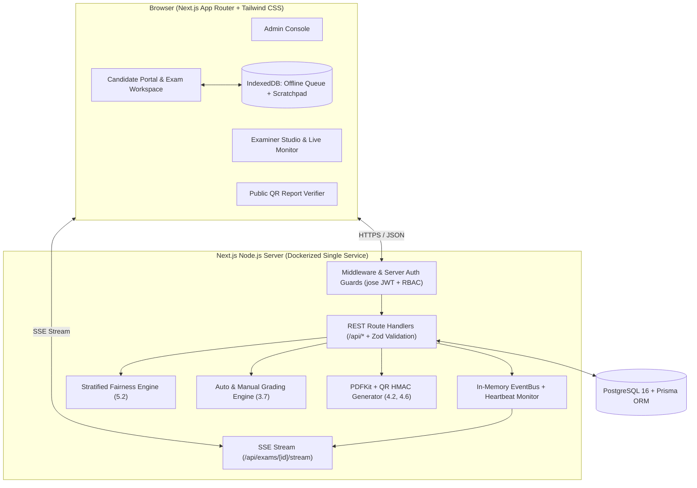

# Master Specification & Architecture Plan — Secure Examination Management System

## Goal Description

Build **AegisExam**, a production-grade, full-stack **Secure Examination Management System** satisfying 100% of the **Core Functional Requirements (3.1–3.8)**, all eight **Secondary Features (4.1–4.8)**, flagship **Open Innovation Challenges (5.2, 5.3, 5.4)**, and **Technical/Submission Constraints (06–07)** defined in `Web-e-Thon Problem Statement.pdf`.

Approved resolutions to specification ambiguities are recorded in [DECISIONS.md](./DECISIONS.md) and take precedence over conflicting wording below.

Following a **Spec-Driven Software Development** workflow, this document serves as the single architectural source of truth (data model, security invariants, API contracts, UI/UX system, and rubric traceability) and divides execution into **five self-contained, verifiable Implementation Plans**:

1. **[Plan 1: Foundation, Auth, RBAC & Admin Operations](./01-foundation-auth-rbac.md)**
2. **[Plan 2: Question Bank, Bulk Import, Exam Lifecycle & Fairness Engine](./02-question-bank-exams-fairness.md)**
3. **[Plan 3: Exam Delivery, Offline Resilience, Workspace & Sandbox](./03-exam-delivery-resilience-workspace.md)**
4. **[Plan 4: Live Monitoring, Grading, Analytics & QR-Verifiable PDFs](./04-monitoring-grading-analytics-reports.md)**
5. **[Plan 5: Dispute Resolution, Polish, Verification & Docker Deployment](./05-disputes-polish-verification-deploy.md)**

---

## User Review Required

> [!IMPORTANT]
> **Open Innovation Selection (Section 05 — 15 Marks)**
> This specification prioritizes **three cleanly separated, non-overlapping innovation pillars** that naturally strengthen the core architecture:
> 1. **5.2 Fairness of Randomized Examinations**: Stratified Topic×Difficulty Blueprint Generator + Deterministic Per-Attempt Seed + Paper Fairness Variance Inspector (proves two candidates receive different questions/orders with mathematically balanced difficulty).
> 2. **5.3 Failure-Resilient Examinations**: Server-Authoritative Lease + Idempotent IndexedDB Offline Answer Queue (`clientSeq` + `capturedAt`) + Server-Observed Outage Incidents & Audited Time Accommodations (prevents fake-offline clock cheating while protecting legitimate outages).
> 3. **5.4 Trust & Dispute Resolution**: Structured Post-Result Appeals (Question Ambiguity, Grading Error, Technical Incident) backed by an immutable Audit Log and automatic regrade/report versioning.

> [!NOTE]
> **Zero Paid APIs & Self-Contained Runtime**
> Every feature runs locally using open-source libraries: Next.js App Router, PostgreSQL 16 (Docker), Prisma ORM, `jose` JWT cookies, `zod`, `papaparse`, `pdfkit`, `qrcode`, `idb`, and `vitest`. Real-time monitoring and announcements use native **Server-Sent Events (SSE)** with a single-instance event bus + DB state fallback, avoiding Redis or external SaaS dependencies.

---

## System Architecture



### Technology Stack
- **Frontend & Backend**: Next.js 15 (App Router, TypeScript `strict: true`), React 19, Tailwind CSS v4, `lucide-react`
- **Database & ORM**: PostgreSQL 16 + Prisma ORM (`prisma/schema.prisma`)
- **Validation**: `zod` schemas shared between API route handlers and client forms
- **Auth & Crypto**: `bcryptjs` (password hashing), `jose` (HS256 signed `httpOnly` cookie session), Node `crypto` (HMAC-SHA256 for report verification codes & deterministic PRNG seeding)
- **Offline & Real-Time**: `idb` (IndexedDB queue + scratchpad persistence) + Native `EventSource` SSE
- **Import & Reporting**: `papaparse` (CSV), `pdfkit` (PDF generation in pure Node), `qrcode` (QR matrix embedded in PDFs)
- **Testing**: `vitest` (unit + API service tests) + `@playwright/test` (E2E critical-path smoke tests)

---

## Requirement Traceability Matrix

| PDF Req | Requirement | Implementation Module | Plan |
|---|---|---|---|
| **3.1** | Role-based auth (Admin, Examiner, Candidate), backend RBAC, user management | `src/lib/auth.ts`, `src/lib/rbac.ts`, `/admin/*`, `/api/admin/users` | Plan 1 |
| **3.2** | Exam config (title, instructions, schedule, duration, marks, settings) & lifecycle (`draft`→`published`→`ongoing`→`completed`) | `Exam` model, `/examiner/exams/*`, `/api/exams/*` | Plan 2 |
| **3.3** | Reusable Question Bank (topics, difficulty, single MCQ, multi-select, written), randomization, attempt snapshot immutability | `Question`, `AttemptQuestionSnapshot`, `/examiner/questions/*` | Plan 2 |
| **3.4** | Candidate enrollment, Candidate dashboard (`available`, `upcoming`, `completed`), eligibility & window checks | `Enrollment`, `/candidate/dashboard`, `/api/exams/[id]/enrollments` | Plan 2 |
| **3.5** | Exam interface: palette (answered/unanswered/review), auto-save, refresh persistence, server-enforced expiry | `/candidate/exams/[id]/take`, `/api/attempts/*` | Plan 3 |
| **3.6** | Live monitoring of attempts, real-time announcements, non-conclusive incident logging | `AttemptEvent`, `Announcement`, `/examiner/exams/[id]/monitor`, SSE | Plan 4 |
| **3.7** | Auto-grading (MCQ + multi-select rules), manual written grading with max-mark validation, review before publish | `src/lib/grading.ts`, `/examiner/exams/[id]/grading` | Plan 4 |
| **3.8** | Controlled result publication, candidate-scoped result view, exam summaries & retention | `/api/exams/[id]/publish-results`, `/candidate/results/[attemptId]` | Plan 4 |
| **4.1** | Network-aware UI: connectivity detection, save/sync indicator, local queue | `NetworkStatusBanner`, `src/lib/offline-queue.ts` | Plan 3 |
| **4.2** | Downloadable PDF reports (candidate scorecard + examiner summary) with RBAC | `src/lib/pdf.ts`, `/api/reports/attempt/[id]/pdf`, `/api/reports/exam/[id]/pdf` | Plan 4 |
| **4.3** | Examination Sandbox (`isSandbox: true` isolated from real results/stats/monitoring) | `Attempt.isSandbox`, `/examiner/exams/[id]/sandbox` | Plan 3 |
| **4.4** | Bulk CSV/JSON import for questions & candidates with row-level error validation | `src/lib/bulk-import.ts`, `/api/import/questions`, `/api/import/candidates` | Plan 2 |
| **4.5** | Question analytics: skip rate, correctness rate, distractor counts, observed difficulty | `src/lib/analytics.ts`, `/examiner/exams/[id]/analytics` | Plan 4 |
| **4.6** | Verifiable reports: unique verification ID + QR code + `/verify/[code]` minimal-exposure check | `ReportVerification`, `/verify/[code]`, `/api/verify/[code]` | Plan 4 |
| **4.7** | Customizable exam workspace (font size, theme/high-contrast, layout, timer display) persisted per user | `UserPreference`, `/api/preferences`, workspace settings drawer | Plan 3 |
| **4.8** | Digital scratchpad (freehand canvas + math/text notes) persisted across refresh | `ScratchpadDrawer`, IndexedDB store | Plan 3 |
| **5.2** | Fairness of Randomized Exams: stratified blueprints + difficulty variance report | `src/lib/fairness.ts`, `ExamBlueprintRule`, Fairness Inspector UI | Plan 2 |
| **5.3** | Failure-Resilient Exams: server lease, offline seq sync, outage detection, audited extensions | `Attempt.hardDeadlineAt`, `timeExtensionMinutes`, `AuditLog` | Plan 3 & 4 |
| **5.4** | Trust & Dispute Resolution: appeal submission, review workbench, regrade + audit trail | `Dispute`, `AuditLog`, `/candidate/results/[id]`, `/examiner/disputes` | Plan 5 |
| **06–07** | Security, server clock, validation, README, test credentials, Docker deploy | `Dockerfile`, `docker-compose.yml`, `prisma/seed.ts`, `README.md` | Plan 1 & 5 |

---

## Core Data Model (`prisma/schema.prisma`)

```prisma
enum Role {
  ADMIN
  EXAMINER
  CANDIDATE
}

enum ExamStatus {
  DRAFT
  PUBLISHED
  ONGOING
  COMPLETED
}

enum QuestionType {
  SINGLE_MCQ
  MULTI_SELECT
  WRITTEN
}

enum Difficulty {
  EASY
  MEDIUM
  HARD
}

enum MultiSelectScoring {
  ALL_OR_NOTHING
  PARTIAL_NO_NEGATIVE
  PARTIAL_WITH_NEGATIVE
}

enum AttemptStatus {
  IN_PROGRESS
  SUBMITTED
  EXPIRED
  GRADED
  PUBLISHED
}

enum DisputeStatus {
  OPEN
  UNDER_REVIEW
  RESOLVED_UPHELD
  RESOLVED_ADJUSTED
  REJECTED
}

model User {
  id           String   @id @default(cuid())
  email        String   @unique
  name         String
  passwordHash String
  role         Role     @default(CANDIDATE)
  studentId    String?  @unique
  isActive     Boolean  @default(true)
  createdAt    DateTime @default(now())
  updatedAt    DateTime @updatedAt

  createdExams Exam[]           @relation("ExaminerExams")
  enrollments  Enrollment[]
  attempts     Attempt[]
  preferences  UserPreference?
  disputes     Dispute[]        @relation("CandidateDisputes")
  auditLogs    AuditLog[]       @relation("ActorAuditLogs")
}

model UserPreference {
  id             String  @id @default(cuid())
  userId         String  @unique
  fontSize       String  @default("md") // sm | md | lg
  theme          String  @default("light") // light | dark | high-contrast
  palettePos     String  @default("right") // left | right
  compactMode    Boolean @default(false)
  hideTimer      Boolean @default(false)
  user           User    @relation(fields: [userId], references: [id], onDelete: Cascade)
}

model Question {
  id             String       @id @default(cuid())
  topic          String
  difficulty     Difficulty
  type           QuestionType
  prompt         String
  optionsJson    Json?        // [{ id: string, text: string }] for MCQ / MULTI_SELECT
  correctIdsJson Json?        // string[] (NEVER exposed to candidate endpoints)
  maxMarks       Float
  explanation    String?
  createdById    String
  createdAt      DateTime     @default(now())
  updatedAt      DateTime     @updatedAt

  examQuestions  ExamQuestion[]
}

model Exam {
  id                     String             @id @default(cuid())
  title                  String
  instructions           String
  status                 ExamStatus         @default(DRAFT)
  scheduledStart         DateTime
  scheduledEnd           DateTime
  durationMinutes        Int
  totalMarks             Float
  passingMarks           Float
  shuffleQuestions       Boolean            @default(true)
  shuffleOptions         Boolean            @default(true)
  useStratifiedBlueprint Boolean            @default(false)
  multiSelectRule        MultiSelectScoring @default(PARTIAL_NO_NEGATIVE)
  negativeMarkRatio      Float              @default(0) // e.g., 0.25 for wrong MCQ
  revealAnswersAfterPublish Boolean          @default(false)
  resultsPublishedAt     DateTime?
  createdById            String
  createdBy              User               @relation("ExaminerExams", fields: [createdById], references: [id])
  createdAt              DateTime           @default(now())
  updatedAt              DateTime           @updatedAt

  examQuestions          ExamQuestion[]
  blueprintRules         ExamBlueprintRule[]
  enrollments            Enrollment[]
  attempts               Attempt[]
  announcements          Announcement[]
  disputes               Dispute[]
}

model ExamQuestion {
  id         String   @id @default(cuid())
  examId     String
  questionId String
  orderIndex Int
  marks      Float    // exam-specific override marks
  exam       Exam     @relation(fields: [examId], references: [id], onDelete: Cascade)
  question   Question @relation(fields: [questionId], references: [id])

  @@unique([examId, questionId])
}

model ExamBlueprintRule {
  id         String     @id @default(cuid())
  examId     String
  topic      String
  difficulty Difficulty
  pickCount  Int
  marksEach  Float
  exam       Exam       @relation(fields: [examId], references: [id], onDelete: Cascade)

  @@unique([examId, topic, difficulty])
}

model Enrollment {
  id         String   @id @default(cuid())
  examId     String
  userId     String
  enrolledAt DateTime @default(now())
  exam       Exam     @relation(fields: [examId], references: [id], onDelete: Cascade)
  user       User     @relation(fields: [userId], references: [id], onDelete: Cascade)

  @@unique([examId, userId])
}

model Attempt {
  id                    String        @id @default(cuid())
  examId                String
  userId                String
  isSandbox             Boolean       @default(false)
  status                AttemptStatus @default(IN_PROGRESS)
  seed                  String
  startedAt             DateTime      @default(now())
  hardDeadlineAt        DateTime
  submittedAt           DateTime?
  lastHeartbeatAt       DateTime      @default(now())
  timeExtensionMinutes  Int           @default(0)
  totalScore            Float?
  maxScore              Float
  fairnessDifficultyAvg Float?
  lastClientSeq         Int           @default(0)

  exam                  Exam                      @relation(fields: [examId], references: [id], onDelete: Cascade)
  user                  User                      @relation(fields: [userId], references: [id], onDelete: Cascade)
  snapshots             AttemptQuestionSnapshot[]
  answers               AttemptAnswer[]
  events                AttemptEvent[]
  verifications         ReportVerification[]
  disputes              Dispute[]

  @@index([examId, userId, isSandbox])
}

model AttemptQuestionSnapshot {
  id               String             @id @default(cuid())
  attemptId        String
  questionId       String
  displayOrder     Int
  type             QuestionType
  topic            String
  difficulty       Difficulty
  promptSnapshot   String
  optionsSnapshot  Json?              // already shuffled per attempt seed, no isCorrect flags
  correctIdsSnap   Json?              // preserved marking key at attempt start
  maxMarks         Float
  multiSelectRule  MultiSelectScoring
  negativeRatio    Float

  attempt          Attempt            @relation(fields: [attemptId], references: [id], onDelete: Cascade)
  answer           AttemptAnswer?

  @@unique([attemptId, questionId])
}

model AttemptAnswer {
  id              String   @id @default(cuid())
  attemptId       String
  snapshotId      String   @unique
  selectedIdsJson Json?    // string[]
  writtenText     String?
  markedForReview Boolean  @default(false)
  clientSeq       Int      @default(0)
  savedAt         DateTime @default(now())
  autoScore       Float?
  manualScore     Float?
  graderFeedback  String?

  attempt         Attempt                 @relation(fields: [attemptId], references: [id], onDelete: Cascade)
  snapshot        AttemptQuestionSnapshot @relation(fields: [snapshotId], references: [id], onDelete: Cascade)
}

model AttemptEvent {
  id         String   @id @default(cuid())
  attemptId  String
  eventType  String   // HEARTBEAT_LOST | RECONNECTED | TAB_BLUR | FULLSCREEN_EXIT | PASTE_BLOCKED | TIME_EXTENDED
  severity   String   @default("INFO") // INFO | NOTICE | REVIEW
  metadata   Json?
  occurredAt DateTime @default(now())

  attempt    Attempt  @relation(fields: [attemptId], references: [id], onDelete: Cascade)
}

model Announcement {
  id        String   @id @default(cuid())
  examId    String
  message   String
  createdBy String
  createdAt DateTime @default(now())

  exam      Exam     @relation(fields: [examId], references: [id], onDelete: Cascade)
}

model Dispute {
  id             String        @id @default(cuid())
  examId         String
  attemptId      String
  candidateId    String
  snapshotId     String?
  category       String        // GRADING_ERROR | AMBIGUOUS_QUESTION | TECHNICAL_INCIDENT | INCIDENT_APPEAL
  description    String
  status         DisputeStatus @default(OPEN)
  resolutionNote String?
  scoreDelta     Float?
  resolvedById   String?
  createdAt      DateTime      @default(now())
  updatedAt      DateTime      @updatedAt

  exam           Exam          @relation(fields: [examId], references: [id], onDelete: Cascade)
  attempt        Attempt       @relation(fields: [attemptId], references: [id], onDelete: Cascade)
  candidate      User          @relation("CandidateDisputes", fields: [candidateId], references: [id])
}

model ReportVerification {
  id            String   @id @default(cuid())
  attemptId     String
  code          String   @unique // short public code e.g. AEG-8F3K-92QX
  signatureHash String   // HMAC-SHA256 of canonical payload
  version       Int      @default(1)
  issuedAt      DateTime @default(now())

  attempt       Attempt  @relation(fields: [attemptId], references: [id], onDelete: Cascade)
}

model AuditLog {
  id          String   @id @default(cuid())
  actorId     String
  action      String
  entityType  String
  entityId    String
  detailsJson Json?
  createdAt   DateTime @default(now())

  actor       User     @relation("ActorAuditLogs", fields: [actorId], references: [id])
}
```

---

## Security, RBAC & Data Integrity Invariants

1. **Backend-Enforced RBAC**: Every protected `/api/*` route calls `requireAuth(allowedRoles)` and verifies ownership (`exam.createdById === session.userId || session.role === 'ADMIN'` or `attempt.userId === session.userId`).
2. **Zero Answer-Key Leakage**: DTO serializers strip `correctIdsJson`, `correctIdsSnap`, and `explanation` from Candidate endpoints. Published-result endpoints may include answers and explanations only when `Exam.revealAnswersAfterPublish` is enabled.
3. **Server-Authoritative Timing**:
   - `hardDeadlineAt = min(startedAt + durationMinutes, scheduledEnd)` computed strictly on PostgreSQL/Node server time.
   - `effectiveDeadlineAt = hardDeadlineAt + timeExtensionMinutes`; every extension is justified in `AuditLog`.
   - Any answer mutation arriving after `effectiveDeadlineAt + 5s` (network grace buffer for in-flight packets whose `capturedAt` or arrival precedes finalization) is rejected with `409 ATTEMPT_EXPIRED` and triggers auto-finalization.
4. **Duplicate Submission Prevention**: PostgreSQL transactional update `WHERE id = $1 AND status = 'IN_PROGRESS'` guarantees an attempt can be finalized once; subsequent `/submit` calls are idempotent and return the existing finalized attempt.
5. **Sandbox Isolation**: All analytics, monitoring, grading queues, and enrollment counts filter `isSandbox: false`.
6. **Non-Conclusive Monitoring Policy (Req 3.6)**: Behavioral/network events use neutral terminology (`Review Signal`, `Connectivity Gap`) and never auto-invalidate an attempt.

---

## UI/UX & Product Design System

- **Visual Direction**: High-trust academic assessment aesthetic — crisp slate/zinc surfaces (`#F8FAFC` background, `#FFFFFF` cards, `#0F172A` ink), deep indigo primary (`#4F46E5`), semantic status pills (`emerald` synced/published, `amber` review/warning, `rose` offline/expired).
- **Accessible & Responsive**: Full keyboard navigation (`1-9`, `N`/`P` next/prev, `M` mark for review), ARIA landmarks, focus rings, and a **High-Contrast Mode** via `UserPreference`.
- **Distinct Workspaces**:
  - **Admin Console**: User directory, role assignment, platform audit log, system health.
  - **Examiner Studio**: Question Bank + Bulk Importer, Exam Builder + Fairness Blueprint Inspector, Live Monitoring Grid + Announcement Broadcast, Grading Workbench, Analytics + PDF Exports, Dispute Queue.
  - **Candidate Portal**: Categorized Exams (`Available`, `Upcoming`, `Completed`), Distraction-Free Exam Workspace (Header Timer + Network Status Pill + Question Area + Collapsible Palette + Scratchpad Drawer + Preferences Popover), Results & Verifiable PDF Download + Dispute Submission.

---

## Verification Plan (Cross-Cutting)

### Automated Verification
- **Unit & Integration (`vitest`)**:
  - RBAC & answer-key redaction tests (`src/lib/__tests__/security.test.ts`)
  - Fairness blueprint stratification & variance bounds (`src/lib/__tests__/fairness.test.ts`)
  - Multi-select & negative marking calculation (`src/lib/__tests__/grading.test.ts`)
  - Server-authoritative timer & idempotent offline sequence reconciliation (`src/lib/__tests__/attempts.test.ts`)
  - QR report HMAC verification & minimal-disclosure check (`src/lib/__tests__/verification.test.ts`)
- **Build & Type Check**: `npx prisma generate && npm run typecheck && npm run lint && npm run build`

### Manual Verification (15-Minute Demo Walkthrough)
- Full live flow across 3 browser sessions (Admin, Examiner, Candidate) covering every item in Section 03, Section 04 (all 8 secondary features), and Section 05 (5.2, 5.3, 5.4).
